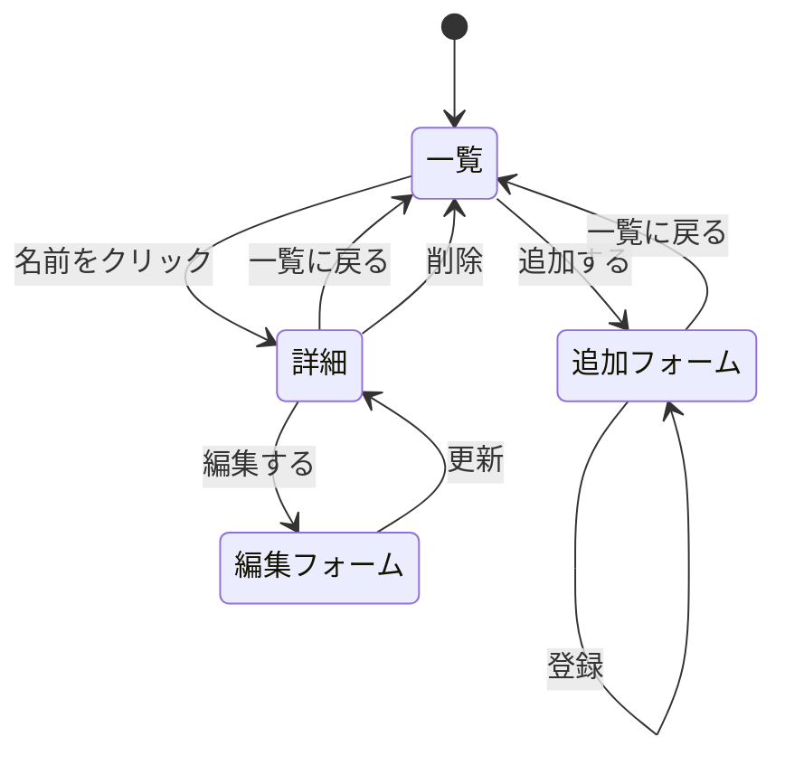

# レポート用システムの計画

## システム1：本棚管理システム

### 対象
自分が持っている本や読みたい本を記録し，読書状況を管理するシステム

### スキーマ
| 項目名 | 型 | 説明 |
|---|---|---|
| id | 数値 | 通し番号 |
| title | 文字列 | 書名 |
| author | 文字列 | 著者 |
| genre | 文字列 | ジャンル |
| status | 文字列 | 読書状況（未読・読書中・読了から選択） |

### ページ遷移

## システム2：映画視聴記録システム

### 対象
自分が見た映画を記録し，評価を付けて振り返るシステム

### スキーマ
| 項目名 | 型 | 説明 |
|---|---|---|
| id | 数値 | 通し番号 |
| title | 文字列 | タイトル |
| director | 文字列 | 監督 |
| year | 数値 | 公開年 |
| rating | 数値 | 評価（1〜5の5段階） |

### ページ遷移

## システム3：雑学図鑑システム

### 対象
知った雑学を記録し，一覧から興味のある雑学の内容を読めるシステム

### スキーマ
| 項目名 | 型 | 説明 |
|---|---|---|
| id | 数値 | 通し番号 |
| title | 文字列 | 雑学のタイトル |
| content | 文字列 | 雑学の内容 |
| genre | 文字列 | ジャンル（動物・歴史など） |
| hee | 数値 | へぇ度（1〜5の5段階） |

### ページ遷移
